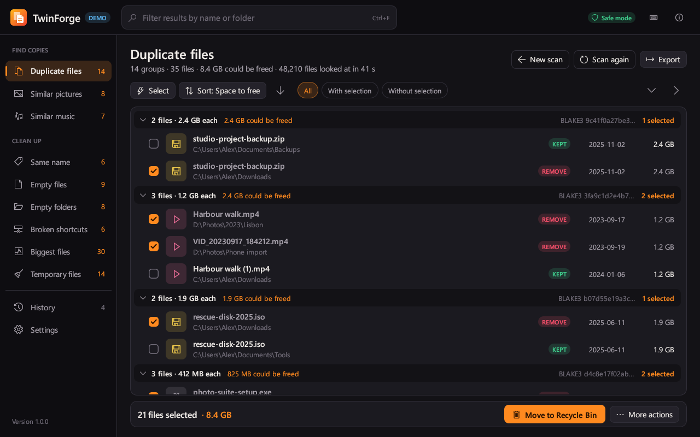
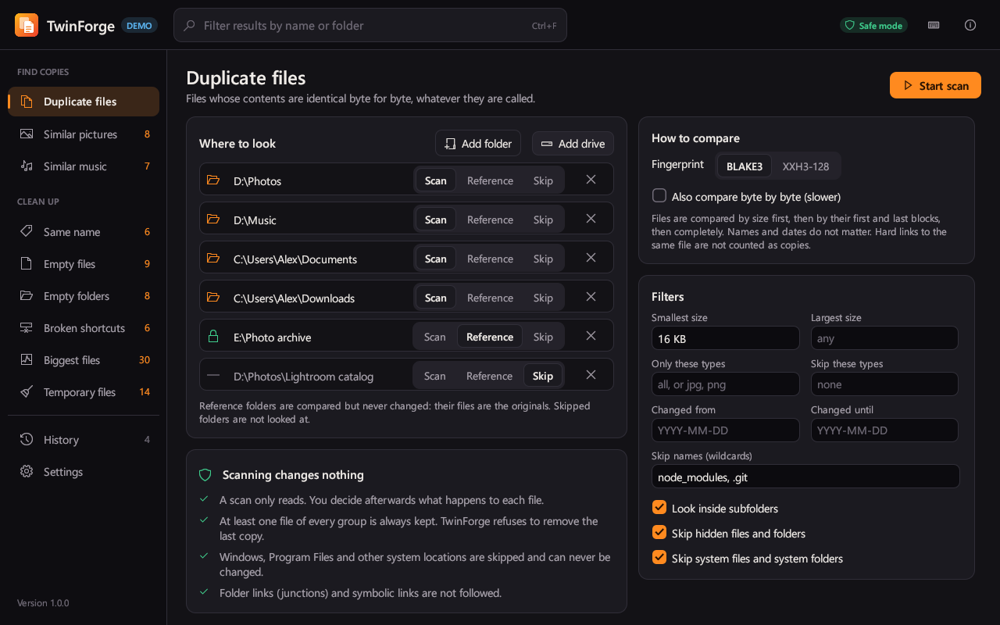
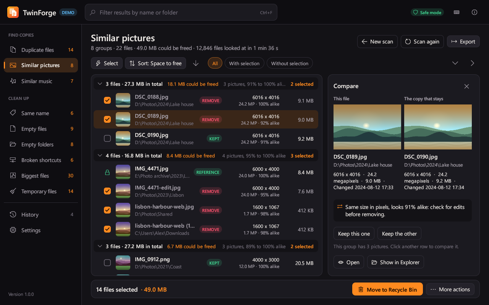
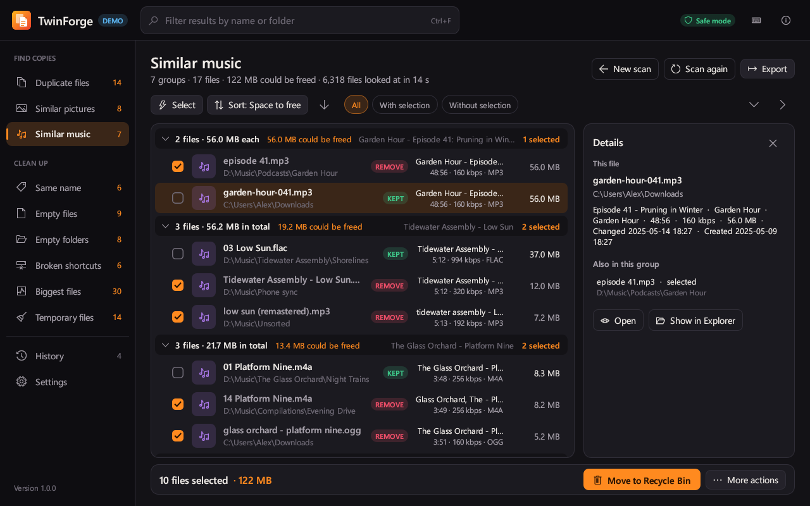
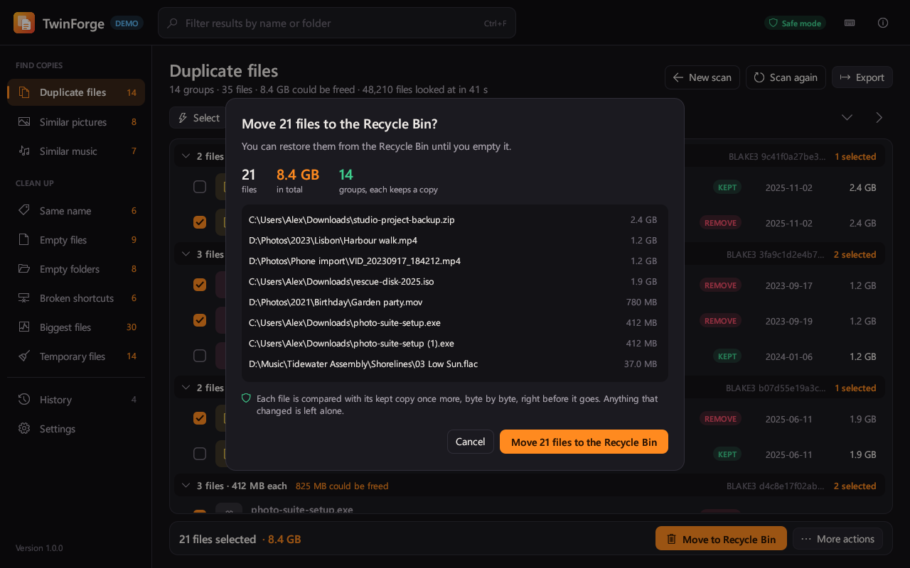
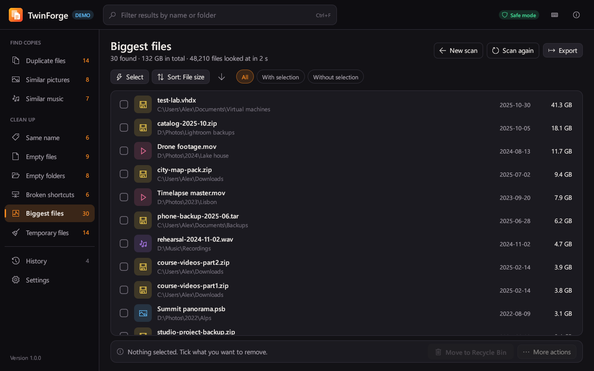
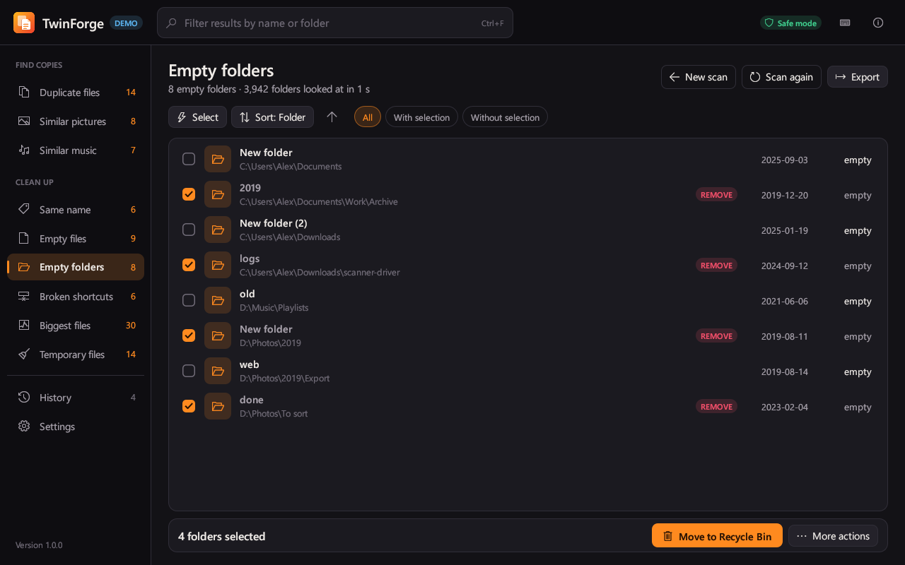
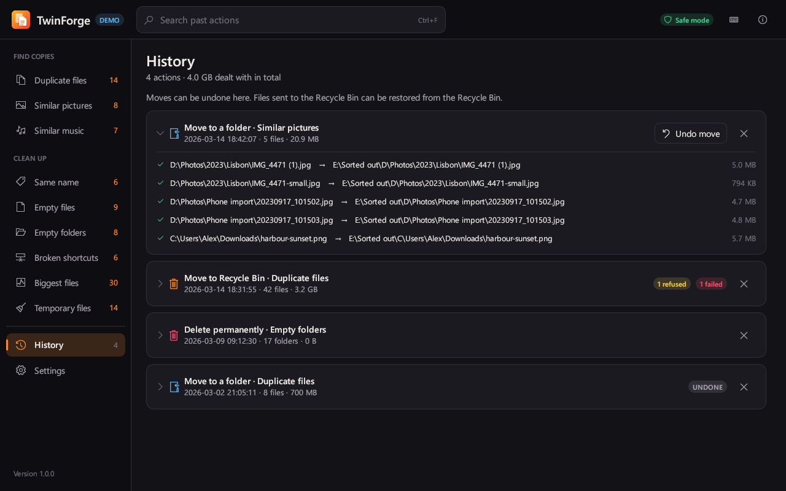
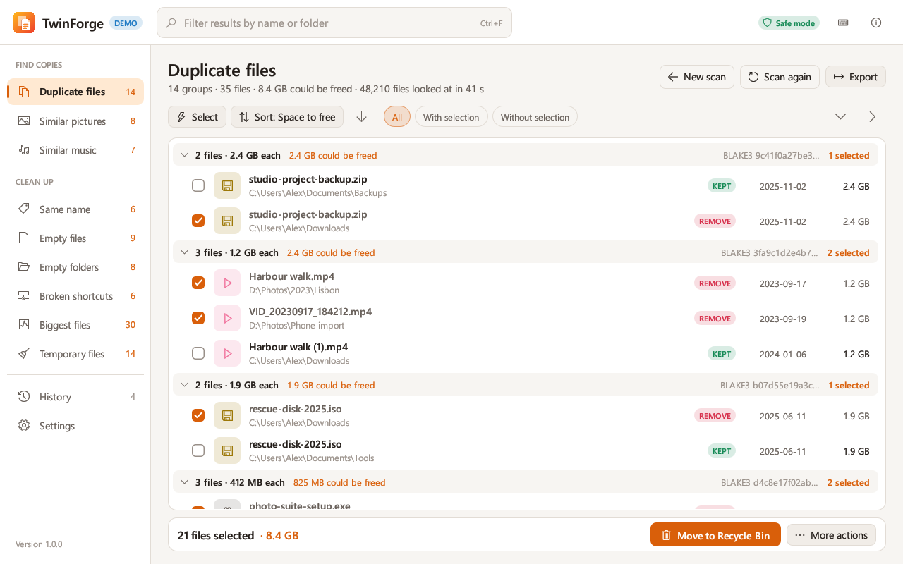

<div align="center">


# TwinForge

### Find duplicate files and look-alike photos, and get your space back.

A duplicate finder for Windows, written in **Rust**.
Exact duplicates, similar pictures, similar music and six clean-up finders, with keep-rules that never let you delete the last copy.

<p>
  
  
  
  
</p>

<p>
  
  
  
  
  
  
  
</p>

[**Features**](#-features) ·
[**Screenshots**](#%EF%B8%8F-screenshots) ·
[**Download**](#-download) ·
[**Safety**](#%EF%B8%8F-safety) ·
[**Limits**](#-good-to-know) ·
[**Developer**](#-developer)



</div>

---

## ✨ Features

<table>
<tr>
<td width="50%" valign="top">

### 📄 Exact duplicates
- Compares by size, then a quick partial hash, then a full hash (BLAKE3 or XXH3-128)
- Optional byte-by-byte confirmation
- Multi-threaded, with progress and cancel
- Knows hard links: the same file reached two ways is not a duplicate
- Remembers hashes between runs, so rescans are fast

</td>
<td width="50%" valign="top">

### 🖼️ Similar pictures
- Finds resized, recompressed, rotated and mirrored copies
- Similarity slider
- Side-by-side compare with resolution, size, date and a difference hint
- "Keep this one / keep the other" in one click

</td>
</tr>
<tr>
<td valign="top">

### 🎵 Similar music and clean-up
- Similar music by artist, title, album and length, with fuzzy matching
- Same name in different folders
- Empty files and empty folders
- Broken shortcuts
- Biggest files and temporary files

</td>
<td valign="top">

### ✅ Smart selection
- Keep newest, oldest, largest, smallest, highest resolution, best audio, shortest or longest path, or by folder order
- **Reference folders:** files there are never selected
- Invert, select by folder, filter and search results
- Running total of files and space selected

</td>
</tr>
<tr>
<td valign="top">

### 🗑️ Actions
- Move to the Recycle Bin (the default)
- Move to a folder, with undo
- Replace duplicates with hard links or symbolic links
- Delete permanently
- History of what was done

</td>
<td valign="top">

### 📤 Export and command line
- Export results to CSV, HTML or JSON
- `TwinForge.exe --scan <folders> --export out.csv`
- Filters by size, type, date and name
- Hidden and system files skipped by default

</td>
</tr>
</table>

## 🖼️ Screenshots

<table>
<tr>
<td width="50%" align="center"><b>Choose what to scan</b><br></td>
<td width="50%" align="center"><b>Similar pictures, side by side</b><br></td>
</tr>
<tr>
<td width="50%" align="center"><b>Similar music</b><br></td>
<td width="50%" align="center"><b>Confirm with exact counts</b><br></td>
</tr>
<tr>
<td width="50%" align="center"><b>Biggest files</b><br></td>
<td width="50%" align="center"><b>Empty folders</b><br></td>
</tr>
<tr>
<td width="50%" align="center"><b>History</b><br></td>
<td width="50%" align="center"><b>Light theme</b><br></td>
</tr>
</table>

<sub>Screenshots use the built-in demo mode (<code>TwinForge.exe --demo</code>), with invented files and generated pictures. Demo mode cannot change anything.</sub>

## 📥 Download

Get it from the [**latest release**](https://github.com/zheerkhalid/twinforge/releases/latest):

| File | What it is |
|---|---|
| `TwinForge-Setup.exe` | Per-user installer with shortcuts and an uninstaller |
| `TwinForge-x.y.z-portable-x64.zip` | Portable: unzip and run |
| `TwinForge.exe` | The bare 7.0 MB EXE |

## 🛡️ Safety

A duplicate finder deletes files, so the engine itself refuses unsafe actions, not just the window:

- **The last copy is never removed.** A plan that would delete every file in a group is refused.
- **Re-checked right before deleting.** If a file's size, date or content changed since the scan, or the copy being kept is missing or changed, the file is left alone.
- **Hard links are understood.** Two names for the same file on disk are never treated as "keep one, delete one".
- **Protected locations are skipped:** Windows, Program Files and other system folders, plus your reference folders.
- **Links are not followed.** Anything reached through a junction is left alone.
- **Recycle Bin by default**, and a confirmation with exact counts and sizes.

## 📌 Good to know

- Similar-picture matching can produce false matches, especially at lower similarity settings. Look at the compare view before removing.
- Similar music compares tags only; there is no audio fingerprinting.
- Not supported yet: similar videos, HEIC, camera RAW and AVIF pictures, and an ignore list for false matches.
- Replacing with symbolic links needs administrator rights or Windows Developer Mode.
- Files are sent to the Recycle Bin one at a time, so very large selections are slow.

## 🏗️ Build from source

Requires Rust (stable, MSVC toolchain) on Windows.

```powershell
git clone https://github.com/zheerkhalid/twinforge
cd twinforge
cargo build --release
# -> target\release\TwinForge.exe
cargo test
```

| Command | What it does |
|---|---|
| `TwinForge.exe --demo` | Invented results; nothing can be changed |
| `TwinForge.exe --scan <folders> --export out.csv` | Scan and export without the window |
| `TwinForge.exe --selftest` | Run every finder and action on a generated temp tree |

```
src/
  dupes.rs / hashing.rs / cache.rs   exact duplicates
  phash.rs / images.rs               similar pictures
  music.rs / fuzzy.rs                similar music
  finders.rs                         the clean-up finders
  select.rs                          keep-rules
  actions.rs                         delete, move, link, with the safety checks
  ui/                                the egui interface
```

The icon is drawn in code at build time. The C runtime is linked statically, so the EXE runs on a clean Windows install.

## 👨‍💻 Developer

<table>
<tr>
<td align="center" width="140">
  <a href="https://zheer.dev">
    
  </a>
</td>
<td>

**Designed and developed by [Zheer Khalid](https://zheer.dev)**

🌐 Website: **[zheer.dev](https://zheer.dev)**  
🐙 GitHub: **[@zheerkhalid](https://github.com/zheerkhalid)**  
🧩 Also by Zheer: **[SnapForge](https://github.com/zheerkhalid/snapforge)**, **[ReelForge](https://github.com/zheerkhalid/reelforge)**, **[UnForge](https://github.com/zheerkhalid/unforge)**, **[KeepForge](https://github.com/zheerkhalid/keepforge)**, **[ShredForge](https://github.com/zheerkhalid/shredforge)**, **[BootForge](https://github.com/zheerkhalid/bootforge)** and **[WireForge](https://github.com/zheerkhalid/wireforge)**

If TwinForge is useful to you, a ⭐ on the repo is appreciated.

</td>
</tr>
</table>

## 📄 License

MIT © 2026 [Zheer Khalid](https://zheer.dev). See [`LICENSE`](LICENSE).

<div align="center">
<sub>Built with 🦀 Rust and ❤️ by <a href="https://zheer.dev">zheer.dev</a></sub>
</div>
